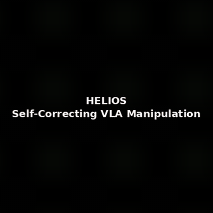

# HELIOS: Outcome Verification and Recovery for VLA Policies

HELIOS is an experimental evaluation framework for vision-language-action (VLA) policies in simulated robotic manipulation. It investigates whether outcome verification and controlled retries can recover failures in SmolVLA execution on LIBERO tasks.



## Experimental results

The archived V4 checkpoint-retry experiment evaluates 30 simulated episodes with up to three attempts per episode.

| Metric | Recorded result |
| --- | ---: |
| First-attempt success | 20/30 (66.7%) |
| Final success with retries | 26/30 (86.7%) |
| Recovered first-attempt failures | 6/10 (60%) |
| Absolute success gain | 20 percentage points |
| Mean attempts per episode | 1.53 |

Source: [experiment summary](results/helios_recovery_v4_30ep/checkpoint_recovery_summary.json) and [episode-level CSV](results/helios_recovery_v4_30ep/checkpoint_recovery_episodes.csv).

## Method

1. Execute SmolVLA on a LIBERO manipulation task.
2. Check completion using LIBERO's simulator-state oracle.
3. If unsuccessful, reset to the intended same initial scenario and change the policy inference seed.
4. Retry up to three attempts, recording outcomes, step counts and elapsed time.

The repository also contains an experimental RGB-only outcome verifier using SmolVLM2-2.2B-Instruct and a separate recovery implementation that explores continuation and simulator-state restoration.

## Repository structure

| Path | Purpose |
| --- | --- |
| [scripts/run_baseline.sh](scripts/run_baseline.sh) | One-shot SmolVLA baseline evaluation |
| [scripts/run_checkpoint_recovery.py](scripts/run_checkpoint_recovery.py) | Controlled stochastic retry experiment (V4) |
| [scripts/run_recovery.py](scripts/run_recovery.py) | Experimental recovery strategies |
| [verifier/oracle_verifier.py](verifier/oracle_verifier.py) | Simulator-state success verification |
| [verifier/visual_verifier.py](verifier/visual_verifier.py) | Experimental vision-language outcome verification |
| [scripts/evaluate_verifier.py](scripts/evaluate_verifier.py) | Verifier evaluation |
| [results/](results/) | Recorded experiment artifacts and figures |

## Getting started

The experiments use Python 3.12, LeRobot, LIBERO, MuJoCo, PyTorch and a CUDA-capable GPU. The environment file provides the base Conda environment:

```bash
git clone https://github.com/LabibBD/helios-vla.git
cd helios-vla
conda env create -f environment.yml
conda activate helios
```

Install a compatible CUDA-enabled PyTorch and LeRobot/LIBERO environment before running the scripts. The [requirements snapshot](requirements-lock.txt) records the original development environment, including unrelated ROS packages; it is not a portable one-command installation file.

With dependencies configured:

```bash
export MUJOCO_GL=egl
python -m scripts.smoke_libero
bash scripts/run_baseline.sh
```

The V4 runner uses the LeRobot evaluation configuration interface. See [the implementation](scripts/run_checkpoint_recovery.py) for the retry protocol and [the baseline script](scripts/run_baseline.sh) for example evaluation arguments.

GitHub Actions currently checks Python syntax; it does not run full GPU or simulator experiments.

## Limitations

- The reported gain is from one 30-episode simulation experiment with a larger attempt budget than one-shot execution.
- The reported success rates use privileged simulator-state verification, not the experimental RGB-only verifier.
- The results do not establish statistically generalizable improvements, equal-compute superiority, or physical-robot performance.
- Exact initial-state consistency and dependency portability merit further validation.

This is a research prototype, not a production robotic control system.
